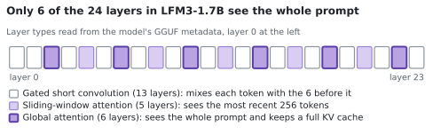
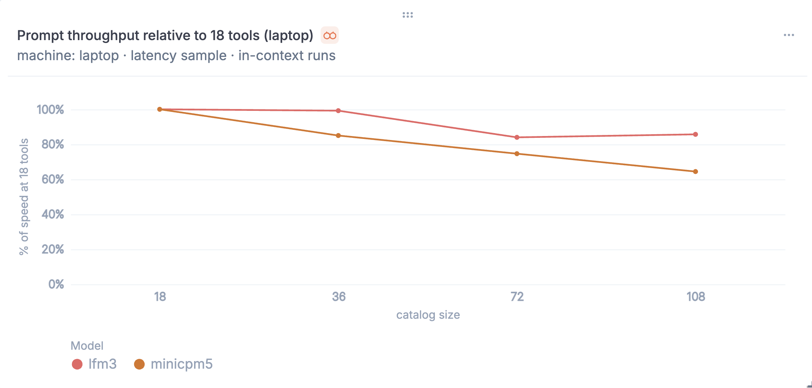
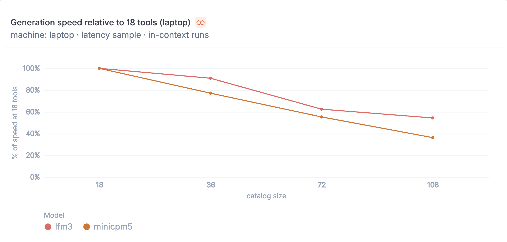

# lfm-toolscale

What happens when a small on-device model gets a large tool catalog? This repo
compares [LFM3-1.7B](https://huggingface.co/LiquidAI/LFM3-1.7B), a hybrid model with
only 6 of its 24 layers attending over the whole prompt, with
[MiniCPM5-2B](https://huggingface.co/openbmb/MiniCPM5-2B), a standard transformer of
similar size, as the catalog grows from 18 to 108 tools. It measures accuracy, the
kinds of mistakes each model makes, speed and memory on a laptop CPU, and whether
deferring tools behind a search step helps.

The accompanying article: *link to come*.

## Findings

- **The architecture shows up in cost.** From 18 to 108 tools, LFM3 keeps 86% of its
  prompt processing speed and 55% of its generation speed on a laptop CPU; MiniCPM5
  keeps 64% and 37%. Measured KV cache growth (12.4 and 41.9 KB per prompt token)
  matches what the layer layouts predict (12 and 42 KB).
- **Accuracy falls as the catalog grows,** from 87.2% to 74.1% for LFM3 and from 88.0%
  to 67.9% for MiniCPM5, mostly because models call a related read-only tool
  (`list_alarms`, `search_contacts`) instead of acting. Which tools are in the catalog
  matters as much as how many.
- **Lookalike confusion is rare** for both models, and removing each request's
  labeled trap had no effect.
- **Neither model reliably searches for tools on its own.** When the harness searches
  for them, accuracy matches keeping all 108 tools in context, at about a quarter of
  the time per request.
- **For LFM3, how found tools are presented matters:** 76.3% with found tools added to
  its tool list, 62.4% in its own deferred-tools format.

Intervals, paired comparisons, and limitations are in the article and in
`results/*/summary.csv`.






## How the experiment works

- **Requests:** 274 English requests from Liquid's
  [phone-assistant-tools](https://huggingface.co/datasets/LiquidAI/phone-assistant-tools)
  dataset whose gold calls use a fixed core of 18 tools, plus no-tool requests capped
  at 15%. The same requests run in every condition.
- **Catalogs:** the core grows to 36, 72, and 108 tools. The 36 and 72-tool catalogs
  use three random orders of the remaining tools, to separate catalog size from the
  effect of specific tools. Lookalike groups (`data/lookalike_groups.json`) keep one
  tool per group in the core.
- **Conditions:** all tools in context; deferred tools where the model decides whether
  to search; deferred tools where the harness searches with the user's request (in
  LFM3's own deferred format, and with found tools added to the tool list); a
  trap-removed catalog for lookalike requests; and a follow-up turn after a lookup.
- **Decoding:** greedy, reasoning off, 512-token limit, with Liquid's system prompt,
  matching Liquid's own evaluation of this dataset.
- **Scoring:** each output gets one failure label (`substituted_call`, `spurious_call`,
  `no_call`, and others), with substitutions split into lookups, labeled traps, other
  lookalikes, and unrelated tools. Confidence intervals resample by gold tool, since
  requests for the same tool are close paraphrases.
- **Machines:** accuracy on a GPU, latency and memory on an Intel MacBook Pro CPU.
  On 300 requests run on both, the machines made identical calls 96.3% of the time and
  gave the same label 98.0% of the time.

A first deferred-tools run used a harness whose instructions conflicted with Liquid's
system prompt; it is kept in `results/archive/deferred_v1` for reference.

## Repo layout

```
data/       evaluation set, catalogs, lookalike groups, trap labels
src/        prompt building, llama-server client, deferred tools, scoring
scripts/    build the experiment, run cells, score, log to Opik, measure memory
results/    raw outputs per machine and model, summaries, server logs
figures/    figures for the article
```

## Setup

Python 3.11 or newer.

```bash
uv venv --python 3.11 && source .venv/bin/activate
uv pip install -r requirements.txt
python scripts/build_experiment.py   # catalogs, evaluation set, trap-removed catalogs
```

Models (not included):

```bash
hf download LiquidAI/LFM3-1.7B-GGUF --include "LFM3-1.7B-Q4_K_M.gguf" --local-dir ~/models
hf download openbmb/MiniCPM5-2B-GGUF --include "MiniCPM5-2B-Q4_K_M.gguf" --local-dir ~/models
```

## Inference setup

Models run with [llama.cpp](https://github.com/ggml-org/llama.cpp), commit
`c406f4367` (build 12555). LFM3 needs build 11960 or newer.

```bash
git clone https://github.com/ggml-org/llama.cpp && cd llama.cpp && git checkout c406f4367
# Laptop (CPU only): Metal off so all runs use the CPU, OpenMP off (mismatched on the test machine)
cmake -B build -DGGML_METAL=OFF -DGGML_OPENMP=OFF
# GPU (accuracy runs): CUDA on, flash-attention kernels off to shorten the build
# cmake -B build -DGGML_CUDA=ON -DGGML_CUDA_FA=OFF
cmake --build build --config Release -j --target llama-server
```

## Running

`scripts/run_all.sh` starts a server for each model, runs a list of cells, and stops
it. Outputs are saved per request and runs resume where they stopped.

```bash
# Laptop: latency samples (30 requests per cell)
caffeinate -i ./scripts/run_all.sh latency
# GPU: all 274 requests, every catalog and order, plus trap-removed
MACHINE=gpu EXTRA="-ngl 99" CELLS="18 36 72 108 36s1 72s1 36s2 72s2 trap_removed" ./scripts/run_all.sh all
# Deferred tools and the follow-up turn
MACHINE=gpu EXTRA="-ngl 99" CELLS="deferred deferred_forced" FOLLOWUP=108 ./scripts/run_all.sh all
```

LFM3's `deferred_forced_plain` cell (found tools in its tool list) runs with
`scripts/run_cell.py` directly; see its help text.

## Scoring

```bash
python scripts/score.py --machine gpu              # summary with intervals
python scripts/score.py --machine gpu --pairs      # most common substitutions
python scripts/score.py --compare 108 deferred_forced
python scripts/score.py --compare-drop 18 108      # does one model lose more?
python scripts/score.py --agreement laptop gpu
python scripts/score.py --machine gpu --opik       # log experiments to Opik
python scripts/measure_memory.py                   # peak memory, laptop
```

## Before committing new results

```bash
cp scripts/hooks/pre-commit .git/hooks/pre-commit   # once per clone
bash scripts/scrub_paths.sh                          # replace home-folder paths with ~
```

## License and credits

Code in this repo is under the Apache License 2.0 (see `LICENSE`). Third-party
material and its licenses are listed in `NOTICE`: the evaluation data comes from
Liquid AI's phone-assistant-tools dataset (Apache 2.0), and the system prompt and
argument comparison rules follow Liquid's GRPO cookbook notebook. Model weights are
not included and are subject to their own licenses.

Background reading: the [LFM2 technical report](https://arxiv.org/abs/2511.23404) and
the [LFM3-1.7B model card](https://huggingface.co/LiquidAI/LFM3-1.7B).
